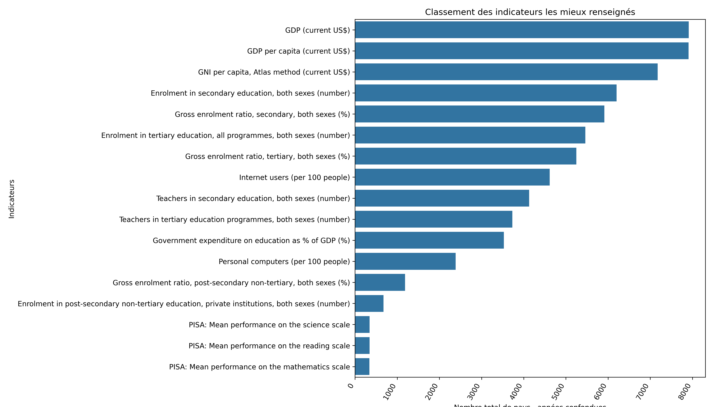

# Analyse des données de systèmes éducatifs — Banque mondiale

Analyse exploratoire du jeu de données **EdStats** de la Banque mondiale, menée pour
éclairer le projet d'expansion internationale d'*academy*, une start-up EdTech qui
diffuse des contenus de formation en ligne à destination d'un public lycée et université.

**Question posée par le métier :** les données éducatives de la Banque mondiale
permettent-elles d'identifier les pays à fort potentiel de clientèle, et de voir comment
ce potentiel pourrait évoluer ?

**Réponse courte :** oui, mais sous conditions. Le jeu de données est exploitable pour un
premier ciblage géographique à partir de sept indicateurs structurants. Il est en revanche
trop lacunaire pour fonder seul une décision d'implantation : l'indicateur le plus
discriminant de la sélection, le score PISA en mathématiques, manque pour **58,6 % des
181 pays** analysés, là où les six autres indicateurs finaux sont renseignés à plus de 91 %.

**[→ Voir la présentation du projet (PDF, 22 slides)](livrables/presentation_projet.pdf)** ·
[le notebook d'analyse](notebooks/analyse_systemes_educatifs.ipynb)

---

## Les données

Cinq fichiers, téléchargés depuis le [catalogue de la Banque mondiale](https://datacatalog.worldbank.org/search/dataset/0038480)
(licence Creative Commons Attribution 4.0).

| Fichier | Lignes | Colonnes | Une ligne représente |
|---|---:|---:|---|
| `EdStatsCountry.csv` | 241 | 32 | un pays, ou un agrégat géographique / économique |
| `EdStatsCountry-Series.csv` | 613 | 4 | un couple pays × indicateur, avec sa description de source |
| `EdStatsSeries.csv` | 3 665 | 21 | un indicateur, avec sa définition et sa catégorie |
| `EdStatsFootNote.csv` | 643 638 | 5 | une note sur un triplet pays × indicateur × année |
| `EdStatsData.csv` | 886 930 | 70 | un couple pays × indicateur, les colonnes portant les années |

Les fichiers bruts ne sont pas versionnés ici : `EdStatsData.csv` pèse 326 Mo, soit au-delà
de la limite de 100 Mio par fichier appliquée par GitHub. La procédure de récupération est
décrite dans [`data/raw/README.md`](data/raw/README.md).

---

## Démarche

### 1. Explorer et fiabiliser

Profilage systématique des cinq fichiers — granularité, doublons, taux de valeurs
manquantes par colonne, statistiques descriptives, occurrences des variables
catégorielles — mutualisé dans la fonction `DataProcessing` et appliqué aux cinq fichiers.
Le travail préparatoire, mené fichier par fichier avant d'être factorisé, est conservé dans
`notebooks/exploration_fichiers_bruts.ipynb`.

Le point sensible est `EdStatsCountry` : il ne contient pas uniquement des pays. S'y mêlent
des agrégats régionaux et des regroupements par niveau de revenu — `SSF` Sub-Saharan
Africa, `LIC` Low income, `WLD` World… — qui fausseraient toute comparaison entre pays. Le
critère de détection retenu est documentaire : un vrai pays possède un code alpha-2 de deux
lettres et une région renseignés. **27 des 241 lignes** sont écartées à ce titre, et toutes
ont en commun une région vide. Vingt-cinq sont des agrégats ; les deux dernières, Gibraltar
et Nauru, sont de vrais territoires que la table laisse sans région. Il reste 214 pays.

Ces faux pays ont été retirés de l'ensemble des tables par deux voies, afin de contrôler la
cohérence du résultat : filtrage par liste d'exclusion (`~df[col].isin(...)`) et jointure sur
la table des vrais pays (`pd.merge(..., how="right")`), qui conserve les 214 pays même
lorsqu'aucune donnée ne leur est associée. Effet sur le périmètre : `EdStatsFootNote` passe
de 643 638 à 516 743 lignes, et la jointure `Data` × `Country` produit une table de 784 310
lignes et 95 colonnes.

### 2. Réduire le périmètre

3 665 indicateurs ne sont pas analysables à la main. La réduction s'est faite en deux temps :
d'abord par le métier, ensuite par la qualité de la donnée.

**Approche métier.** La colonne `Topic` de `EdStatsSeries` range les 3 665 indicateurs en
37 catégories. Neuf ont été retenues, en partant de quatre besoins d'*academy* : l'accès au
matériel informatique et à internet, la qualité du système éducatif, la facilité d'accès à
l'enseignement, et un environnement économique ni trop fragile ni déjà saturé.

`Secondary` · `Tertiary` · `Post-Secondary/Non-Tertiary` · `Teachers` ·
`Learning Outcomes` · `Expenditures` · `Infrastructure: Communications` ·
`Economic Policy & Debt: National accounts: Atlas GNI & GNI per capita` ·
`Economic Policy & Debt: National accounts: US$ at current prices: Aggregate indicators`

Il reste **1 715 indicateurs**, parmi lesquels **17** ont été retenus pour leur lecture
métier directe.

**Traitement des années.** Le fichier `Data` contient des colonnes allant jusqu'à 2100. Ce
sont des projections, identifiables dans le libellé de l'indicateur et porteuses
d'incertitude. Seules les années observées ont été conservées, et l'agrégation finale
s'appuie sur la fenêtre **1999–2015** : le taux d'indicateurs renseignés y franchit un
palier net, passant de 41 % en 1998 à 53 % en 1999, puis se maintenant au-dessus de 50 %,
contre 16 à 41 % sur les décennies antérieures.

**Approche data.** Calcul de la proportion de valeurs renseignées par année, puis par
indicateur, puis du nombre de pays renseignés pour chaque couple indicateur × année. Le
croisement de cette richesse en données avec la pertinence métier ramène la sélection à
**15 indicateurs**.

**Consolidation.** Passage à une table *un pays par ligne, un indicateur par colonne* via
`pivot_table`. Les années sont résumées par la **dernière valeur non nulle** disponible,
après écrêtage des valeurs aberrantes à l'écart interquartile. Les pays renseignés à moins
de 70 % sur les indicateurs retenus ont été écartés : **181 pays** conservés.

### 3. Analyser et recommander

**Dé-corrélation.** Matrices de corrélation de Pearson, qui capte les relations linéaires,
et de Spearman, monotone et plus robuste aux valeurs extrêmes comme aux distributions
asymétriques. Au-delà de **r ≥ 0,7**, deux indicateurs disent la même chose : le plus
parlant pour le métier a été conservé, et chaque arbitrage est argumenté dans le notebook.
Les trois échelles PISA, très corrélées entre elles, sont par exemple ramenées à celle de
mathématiques ; le GNI par habitant cède la place au PIB par habitant, plus proche des
conditions économiques internes.



Restent **7 indicateurs**, faiblement corrélés entre eux :

| Indicateur | Besoin d'*academy* couvert | Poids |
|---|---|---:|
| Gross enrolment ratio, tertiary, both sexes (%) | facilité d'accès à l'enseignement supérieur | 0,20 |
| PISA: Mean performance on the mathematics scale | qualité du système éducatif | 0,20 |
| Personal computers (per 100 people) | accès au matériel informatique | 0,20 |
| Government expenditure on education as % of GDP (%) | priorité budgétaire donnée à l'éducation | 0,15 |
| GDP per capita (current US$) | pouvoir d'achat individuel | 0,15 |
| Teachers in secondary education, both sexes (number) | encadrement du système secondaire | 0,05 |
| GDP (current US$) | taille du marché | 0,05 |

**Méthode de sélection des pays.** Un pays intéressant n'est ni déjà saturé ni trop
instable. Chaque indicateur est donc normalisé à l'intérieur de son intervalle
interquartile : un score de 0 à 1 entre Q1 et Q3, et 0 en dehors. Les pays les plus
développés comme les pays à faible revenu sortent ainsi du classement. Deux agrégations ont
été calculées — moyenne simple des sept scores, puis moyenne pondérée selon les poids
ci-dessus. C'est la seconde qui est retenue, la première traitant tous les indicateurs comme
également importants.

---

## Résultats

Classement pondéré, cinq premiers pays sur les 181 évalués :

| Rang | Pays | Score |
|---:|---|---:|
| 1 | Hongrie | 0,764 |
| 2 | Serbie | 0,580 |
| 3 | Slovaquie | 0,566 |
| 4 | Roumanie | 0,545 |
| 5 | France | 0,529 |

Un bloc d'Europe centrale et orientale se dégage. C'est la conséquence directe de la
méthode : en annulant le score hors de l'intervalle interquartile, elle écarte par
construction les pays les plus riches comme les plus pauvres, et fait donc remonter des
pays intermédiaires dotés d'un système éducatif déjà développé.

### Limites à garder en tête

- **Les valeurs manquantes sont traitées comme des zéros** dans le calcul du score. Le score
  PISA manquant pour 58,6 % des pays et pesant 0,20 dans la pondération, un pays non couvert
  est pénalisé par absence de mesure et non par faiblesse réelle. C'est le principal biais
  du classement.
- **Le seuil de dé-corrélation porte sur le coefficient signé**, non sur sa valeur absolue :
  une forte corrélation négative (r ≤ −0,7) ne serait pas repérée comme une redondance.
- **Les poids relèvent d'un choix métier**, non d'un résultat statistique. Ils sont
  regroupés dans un dictionnaire unique et modifiables en une ligne pour tester d'autres
  hypothèses de ciblage.
- **Les données s'arrêtent en 2015** sur la fenêtre retenue. Elles décrivent un potentiel
  structurel, pas une situation de marché actuelle.
- **Aucune donnée de concurrence ni de demande effective** n'est présente dans EdStats. Le
  classement hiérarchise un potentiel, il ne valide pas un marché.

---

## Reproduire l'analyse

L'environnement est géré avec [uv](https://docs.astral.sh/uv/). Les versions exactes sont
figées dans `uv.lock`.

```bash
# 1. Installer l'environnement a l'identique
uv sync

# 2. Recuperer les donnees brutes dans data/raw/ (voir data/raw/README.md)

# 3. Lancer JupyterLab
uv run jupyter lab
```

Tout se joue dans `notebooks/analyse_systemes_educatifs.ipynb`, qui déroule les trois
parties de l'analyse de bout en bout. Les chemins y sont relatifs, il n'y a rien à adapter.

`exploration_fichiers_bruts.ipynb` n'est pas nécessaire pour reproduire l'analyse : le
notebook principal refait lui-même le profilage des cinq fichiers.

---

## Arborescence

```
.
|-- data/
|   |-- raw/             # 5 fichiers EdStats (non versionnes, voir son README)
|   `-- processed/       # tables intermediaires et de resultats
|-- notebooks/
|   |-- analyse_systemes_educatifs.ipynb     # LE notebook : parties 1, 2 et 3
|   `-- exploration_fichiers_bruts.ipynb     # profilage prealable des 5 fichiers
|-- src/
|   `-- fonctions_exercice1.py             # DataProcessing : profilage standardise
|-- outputs/
|   |-- figures/         # heatmaps, distributions, classements
|   `-- tables/          # matrices de correlation, choix des indicateurs
|-- livrables/           # presentation du projet (PDF)
|-- pyproject.toml       # dependances du projet
`-- uv.lock              # versions figees
```

---

## Stack

Python · pandas · NumPy · SciPy · Matplotlib · seaborn · openpyxl · JupyterLab · uv

## Source et licence

Données : *Education Statistics*, Banque mondiale —
[catalogue](https://datacatalog.worldbank.org/search/dataset/0038480), licence
[Creative Commons Attribution 4.0](https://creativecommons.org/licenses/by/4.0/).

Projet réalisé par Faïza Khelladi dans le cadre d'un parcours Data Scientist / ML Engineer.
